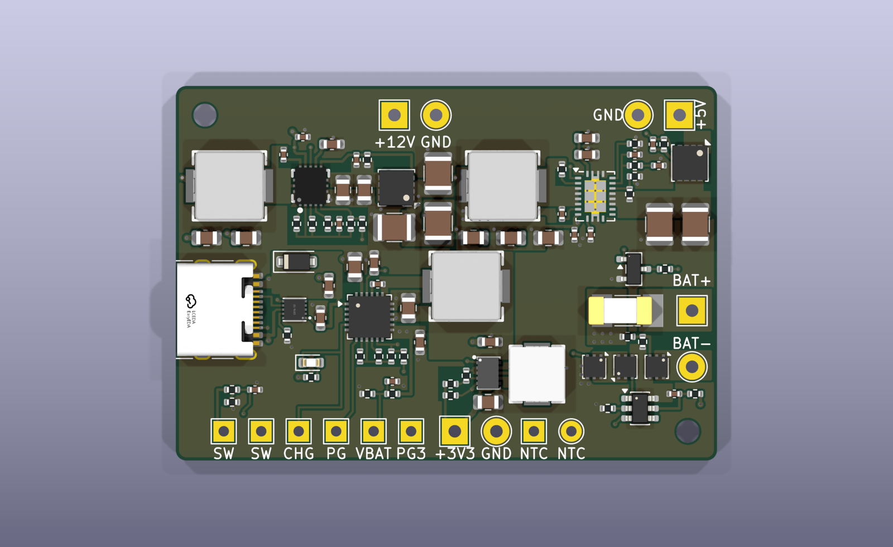

# minipc-power

Small power board for MCU-based emulator builds (Pico / ESP32 class with a 12 V 5" LCD). Runs from USB-C or a 1S2P
18650 pack, charges the pack whenever USB-C is plugged in, and supplies 12 V, 5 V and 3.3 V.

## Features

- **USB-C PD input:** requests 9 V (CH224Q), falls back to 5 V on non-PD chargers; TVS on VBUS.
- **Charger:** BQ25606 standalone switching charger, 1.44 A charge to 4.2 V, 1.9 A input limit. Power path: the
  board runs from USB even with a dead or missing pack. NTC input for charge-temperature limits.
- **Battery protection** for bare cells: HY2113 protector (over-charge 4.28 V, over-discharge 2.80 V, over-current,
  short circuit), 10 A fuse, reverse-polarity FET.
- **Outputs**, all switched together by one on/off switch (off by default):
  - **12 V, 0.5 A:** TPS61178 synchronous boost with output disconnect (for the LCD)
  - **5 V, 2.5 A:** TPS61088-Q1 synchronous boost with a soft-start load switch
  - **3.3 V, 1.5 A:** TPS63802 buck-boost (regulated across the whole battery range)
- **Power budget:** 15 W combined as a peak; about 10-12 W continuous in a closed box (see `docs/thermal.md`).
- **Solder pads** for everything: battery, outputs, on/off switch, NTC, status (charging, power good, 3.3 V good,
  battery voltage sense).
- **Board:** 52 x 36 mm, 4 layers (JLCPCB JLC04161H-7628), parts from LCSC; every part has its datasheet link.

## Status

Design reviewed, not yet built. Bench checks to run first: `docs/power-design.md` s9 and `docs/review-2026-10-24.md`.
`hardware/production/` predates the latest board changes: regenerate it before ordering.

## Files

- `hardware/` - KiCad 10 project (schematic, board, symbols, footprints, 3D models)
- `tools/` - the schematic and board are generated by these scripts; edit them, not the KiCad files:
  `python3 tools/gen_schematic.py && bash tools/build_board.sh` (needs KiCad 10 and
  [kicad-skills](https://github.com/jvanderberg/kicad-skills))
- `docs/requirements.md` - requirements and architecture (start here)
- `docs/power-design.md` - every component value and where it comes from
- `docs/thermal.md` - heat budget
- `docs/review-2026-10-24.md` - design review: fixed, open, owner decisions, bench checks
- `docs/layout-compliance.md` - each converter's layout against its datasheet
- `docs/skill-gaps.md` - problems found in the kicad-skills plugin while designing this board
